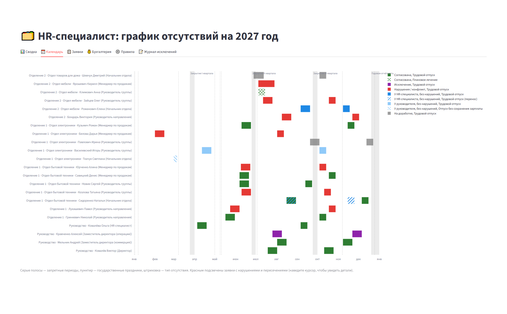
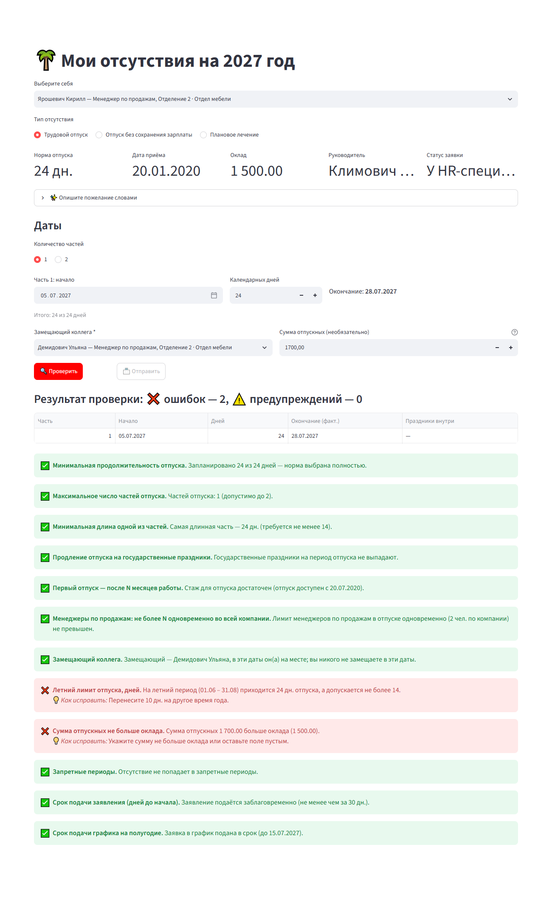
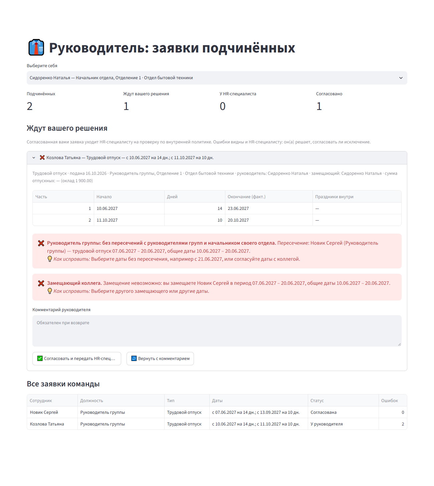
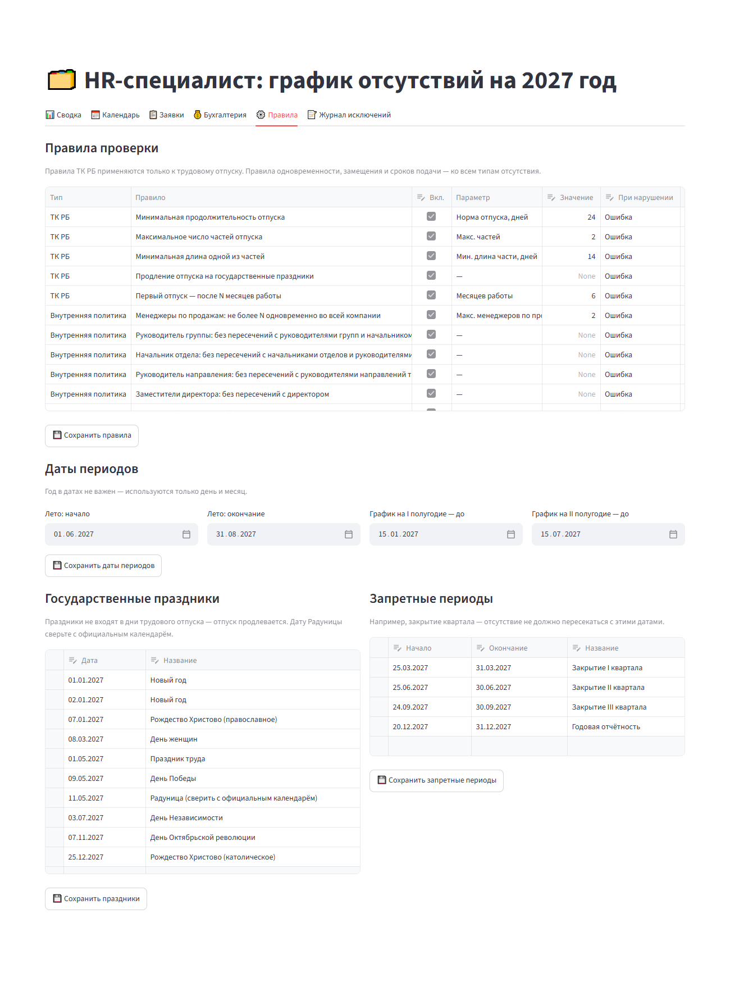

# Планировщик отпусков

Веб-приложение для планирования и согласования отпусков: сотрудник подаёт заявку и сразу видит, соответствует
ли она Трудовому кодексу Республики Беларусь и внутренним правилам компании; руководитель и HR-специалист
согласуют заявки, видят конфликты на общем календаре и выгружают список отсутствий для бухгалтерии.

## Проблема

График отпусков во многих компаниях до сих пор собирают вручную: рассылают таблицу, сотрудники вписывают
даты, а потом кадровик неделями сверяет их с законом (24 дня, деление на части, праздники, стаж) и с
внутренними правилами: не уходят ли одновременно ключевые сотрудники, которые подменяют друг друга, не
отдыхает ли замещающий, не превышен ли летний лимит, поданы ли заявления в срок. Ошибки и пересечения
находятся поздно, согласование идёт по почте и в мессенджерах, график переделывают по нескольку раз.

## Решение

- Сотрудник сам выбирает тип отсутствия и даты и **сразу** видит результат проверки по каждому правилу:
  ✅ / ⚠️ / ❌, понятное объяснение и подсказку, как исправить.
- Заявка проходит согласование в два этапа: **Руководитель** (непосредственный) → **HR-специалист**.
- HR-специалист видит общий календарь с подсвеченными конфликтами, согласует заявки или оформляет исключения
  с обязательным комментарием в журнале и выгружает для бухгалтерии список отсутствий на следующий месяц.
- **Все правила и их значения настраивает HR** прямо в интерфейсе — без участия программиста.
- Пожелание можно описать словами («две недели в сентябре после 5-го») — AI подставит даты в форму, а
  проверку всегда выполняет детерминированный движок правил.

## Скриншоты

Все данные на скриншотах — демо-данные из `seed.py`, ФИО вымышленные.

**HR-специалист: календарь отсутствий.** Красным подсвечены конфликты, фиолетовым — согласованные
исключения, штриховкой — тип отсутствия, серыми полосами — запретные периоды.



| Сотрудник: проверка заявки | Руководитель: заявки команды |
|---|---|
|  |  |

**HR-специалист: настройка правил** — включение, значения и строгость каждого правила, летний период, сроки
графика, праздники и запретные периоды.



## Возможности по ролям

### «Сотрудник»
1. Выбрать себя. Видны норма отпуска, дата приёма, оклад, руководитель и статус заявки (и комментарии
   руководителя или HR-специалиста, если заявку вернули).
2. Выбрать тип отсутствия: **трудовой отпуск**, **отпуск без сохранения зарплаты**, **плановое лечение**.
3. Указать даты: для трудового отпуска 1 или 2 части, для остальных типов — один период. Фактическая дата
   окончания с учётом праздников видна сразу (праздники продлевают только трудовой отпуск).
4. Выбрать **замещающего коллегу** (обязательно) и при желании указать **сумму отпускных** (не больше оклада;
   для отпуска без сохранения зарплаты поле недоступно).
5. Для трудового отпуска можно описать пожелание словами — AI подставит даты в форму.
6. «Проверить» → результат по каждому правилу. «Отправить» доступна, если нет ошибок; заявка уходит
   руководителю (у кого руководителя нет — сразу HR-специалисту). Новая заявка заменяет предыдущую
   несогласованную того же типа.
7. Если отпуск уже согласован, есть кнопка **«Перенести согласованные даты»** — создаётся заявка на перенос.
   Пока перенос не согласован, действуют прежние даты.

### «Руководитель»
Выбрать себя (в списке только те, у кого есть подчинённые). Видны заявки непосредственных подчинённых,
ожидающие решения, с полным результатом проверки. Кнопки «Согласовать и передать HR-специалисту» и «Вернуть
с комментарием» (комментарий обязателен). Ниже — все заявки команды и кто ещё не подал трудовой отпуск.

### «HR-специалист»
- **Сводка** — заявки по этапам (у руководителей / ждут HR-специалиста / согласовано), ошибки, кто ещё не
  подал трудовой отпуск, нарушения по правилам, разбивка по подразделениям.
- **Календарь** — диаграмма Ганта на год по оргструктуре. Цвет — состояние заявки (красный — нарушения),
  штриховка — тип отсутствия, серые полосы — запретные периоды, пунктир — праздники.
- **Заявки** — «Согласовать» (недоступна при ошибках), «Вернуть на доработку» (с комментарием),
  «Согласовать исключение» (комментарий обязателен, вместе с перечнем нарушений сохраняется в журнал). Для
  переноса показано «было → стало»; при согласовании переноса исходная заявка получает статус «Перенесена».
- **Бухгалтерия** — согласованные отсутствия (включая исключения), которые начинаются в следующем месяце:
  ФИО, тип, даты, сумма отпускных. Выгрузка в CSV (для Excel: разделитель `;`, UTF-8 с BOM) и XLSX.
- **Правила** — включение/выключение правил, их параметры и строгость (ошибка или предупреждение), даты
  летнего периода и сроков графика, праздники, запретные периоды. Изменения применяются сразу: все заявки
  пересчитываются при каждом открытии страницы.
- **Журнал исключений** — кто, когда и почему согласовал заявку с нарушениями.

В сайдбаре есть **«Текущая дата (для демо)»**: от неё считаются сроки подачи и «следующий месяц» для
бухгалтерии. По умолчанию — сегодняшняя дата.

## Какие правила поддерживаются

Каждая проверка возвращает результат с объяснением и подсказкой. **Все правила можно включить или выключить,
а их значения, даты и строгость (ошибка / предупреждение) меняет HR-специалист на вкладке «Правила».**
Значения ниже — это значения по умолчанию.

### Трудовой кодекс Республики Беларусь (трудовой отпуск)

| Правило | По умолчанию |
|---|---|
| Минимальная продолжительность отпуска (индивидуальная норма сотрудника имеет приоритет) | 24 календарных дня |
| Максимальное число частей отпуска | 2 |
| Одна из частей — не короче N дней | 14 дней |
| Государственные праздники не входят в дни отпуска — отпуск продлевается | вкл. |
| Первый отпуск — не ранее чем через N месяцев работы | 6 месяцев |

Эти правила применяются только к трудовому отпуску; к отпуску без сохранения зарплаты и плановому лечению —
нет (праздники их тоже не продлевают).

### Пример настраиваемых внутренних правил

Это пример внутренней политики компании: набор правил, который HR адаптирует под свою оргструктуру.

| Правило | Что проверяется | По умолчанию |
|---|---|---|
| **Иерархия одновременности по должностям** | Люди, которые подменяют друг друга, не отсутствуют одновременно: руководитель группы — с другими руководителями групп и начальником своего отдела; начальник отдела — с другими начальниками отделов и руководителями направлений своего отделения; руководитель направления — с другими руководителями направлений того же заместителя директора и с этим заместителем; заместители директора — с директором | ошибка |
| **Лимит менеджеров по продажам** | Не более N менеджеров по продажам компании отсутствуют в один день; в сообщении — кто именно и в какие даты | 2 человека |
| **Срок подачи заявления** | Заявление подаётся не позднее чем за N дней до начала отсутствия | 30 дней |
| **Срок графика на полугодие** | Заявка в график на I / II полугодие подаётся до заданной даты | 15.01 / 15.07, предупреждение |
| **Перенос согласованного отпуска** | Перенос подаётся не позднее чем за N дней до начала исходной части | 14 дней |
| **Летний лимит** | В летний период — не более N дней трудового отпуска (обе части вместе, праздники не считаются) | 14 дней, 01.06–31.08 |
| **Замещающий коллега** | Поле обязательно; замещающий не отсутствует в эти даты, а сотрудник не отдыхает, когда сам кого-то замещает | ошибка |
| **Сумма отпускных** | Необязательное поле, не больше оклада; для отпуска без сохранения зарплаты — пустое | ошибка |
| **Запретные периоды** | Отсутствие не попадает в закрытие квартала, годовую отчётность и т. п. | список редактируется |

Всегда (без настройки) проверяется, что разные отсутствия одного сотрудника не пересекаются.

Правила одновременности, замещения и сроков подачи действуют для **всех типов отсутствия**: учитываются
заявки в статусах «У руководителя», «У HR-специалиста», «Согласована», «Исключение».

**Симметричность.** Ограничение «А не пересекается с Б» проверяется в обе стороны: руководитель направления,
который подаёт отпуск на даты начальника отдела своего отделения, тоже получит ошибку. Конфликт, который
находят два правила (например, «заместители — директор» и «директор — заместители»), показывается один раз.

**Перенос.** Неизменённые части уже согласованы, поэтому конфликты (одновременность, замещающий, запретные
периоды) и срок подачи проверяются только для новых дат; правила ТК и летний лимит — по всему отпуску; срок
графика к переносу не применяется.

**Упрощения прототипа:** не учитываются перенос рабочих дней, дополнительные отпуска, рабочий год (вместо
календарного), остатки неиспользованных дней; у сотрудника одна текущая заявка каждого типа на год.
Праздники 2027 года в демо-данных можно отредактировать на вкладке «Правила» (дату Радуницы стоит сверить с
официальным календарём — она меняется каждый год).

## Почему правила в коде, а AI только для разбора текста

- **Правила — это закон и внутренняя политика.** Результат должен быть детерминированным, одинаковым для всех
  и объяснимым: «пересечение с Отделов А (Начальник отдела) 08.09–15.09». LLM может ошибиться в арифметике с
  датами, а такую ошибку невозможно отследить и оспорить.
- **Проверяемость.** Движок `rules_engine.py` — чистые функции без Streamlit и БД, покрытые тестами.
  Изменение правила — это изменение параметра в таблице, а не промпта.
- **AI делает только то, в чём он хорош**: превращает «хочу две недели в сентябре после 5-го» в даты. Его
  ответ — строгий JSON, который валидируется и подставляется в форму. Дальше проверку выполняет движок.
- **Работает без AI.** Если ключа нет, поле показывает «AI-разбор недоступен, введите даты вручную», всё
  остальное работает полностью. Персональные данные в LLM не уходят — только текст пожелания.

## Стек

- **Python 3.11+**
- **Streamlit** — интерфейс
- **SQLite** — хранение (стандартная библиотека `sqlite3`)
- **pandas**, **Plotly** — таблицы и диаграмма Ганта; **openpyxl** — выгрузка в Excel
- **OpenAI API** (опционально) — разбор пожелания в свободной форме; **python-dotenv** — загрузка ключа из `.env`
- **pytest** — тесты

## Архитектура

```
app.py           Streamlit UI: роли «Сотрудник», «Руководитель», «HR-специалист»
rules_engine.py  чистые функции проверки: ТК РБ, правила по должностям, лето, сроки, перенос, замещающий
storage.py       SQLite: отделения, отделы, сотрудники, заявки (тип, замещающий, сумма, перенос),
                 правила с параметрами, праздники, запретные периоды, журнал исключений, список для бухгалтерии
ai_parser.py     опциональный разбор пожелания через OpenAI (строгий JSON)
seed.py          демо-данные: 2 отделения, 4 отдела, 28 сотрудников, заявки с нарушениями и пересечениями
tests/           pytest: движок правил (test_rules.py) и согласование/перенос/бухгалтерия (test_storage.py)
```

Каждая проверка возвращает `CheckResult(rule_code, rule_name, status, message, hint)`, где `status` —
`ok` / `error` / `warning`. Схема БД версионируется (`PRAGMA user_version`): база старого формата при запуске
пересоздаётся с демо-данными.

**Демо-оргструктура** (все ФИО вымышленные): 28 сотрудников. Директору подчиняются заместитель директора
(коммерция), заместитель директора (операции) и HR-специалист. 4 руководителя направлений (по два в каждом
отделении; трое подчиняются заместителю по коммерции, один — заместителю по операциям). 2 отделения × 2
отдела; в каждом отделе начальник отдела и 2 руководителя групп; 8 менеджеров по продажам подчиняются
руководителям групп. Сценарий показа — в [DEMO.md](DEMO.md).

## Как запустить

```powershell
python -m venv .venv
.venv\Scripts\activate          # Linux/macOS: source .venv/bin/activate
pip install -r requirements.txt
streamlit run app.py
```

При первом запуске создаётся `vacation.db` с демо-данными. Сбросить данные: кнопка «Сбросить демо-данные»
в сайдбаре или `python seed.py`. Путь к базе можно задать переменной окружения `VACATION_DB`.

### AI-разбор (опционально)

Скопируйте `.env.example` в `.env` и укажите `OPENAI_API_KEY` (или задайте переменную окружения). Модель по
умолчанию — `gpt-4o-mini`, меняется через `OPENAI_MODEL`.

## Тесты

```powershell
python -m pytest -q
```

Тесты покрывают все правила движка (границы сроков, симметричность правил одновременности, перенос,
настраиваемые значения и строгость) и слой хранения (двухэтапное согласование, исключения, перенос, список
для бухгалтерии).

## Как развивать дальше

- **Интеграция с 1С:ЗУП / HR-системой**: синхронизация оргструктуры, окладов, остатков отпуска; расчёт
  отпускных в учётной системе вместо ручного ввода; формирование приказов.
- **Вход через корпоративную учётную запись** (Active Directory / SSO) вместо выбора себя из списка.
- **Уведомления**: руководителю — о новой заявке, HR-специалисту — о согласованной руководителем, сотруднику —
  о возврате; напоминания о сроках графика.
- **Конструктор правил одновременности**: задавать пары должностей и область (отдел / отделение / компания)
  в интерфейсе, а не в коде.
- **Интеграция с календарём** (Outlook / Google Calendar) и **Telegram-бот** для подачи заявок.
- **Автоматическое предложение альтернативных дат**: поиск ближайших окон, где выполнены все правила.
- Производственный календарь с переносами рабочих дней, дополнительные отпуска, рабочий год вместо
  календарного, учёт остатков прошлых лет, несколько заявок одного типа в год.
